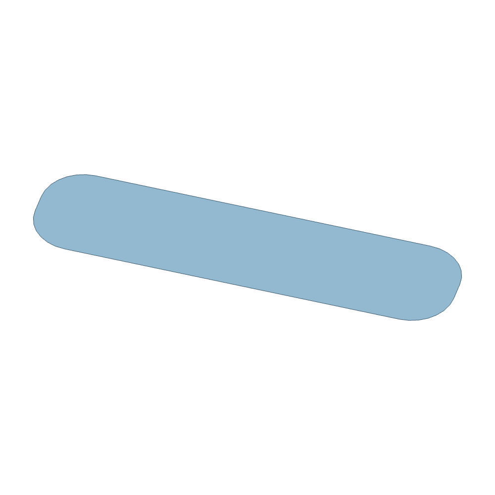

###### Note: Do not edit this file directly, it is automatically generated from the CAD model

# Rounded_Rectangle

## Inputs

- **X_Length** (number)
- **Y_Length** (number)
- **Radius** (number)

 

